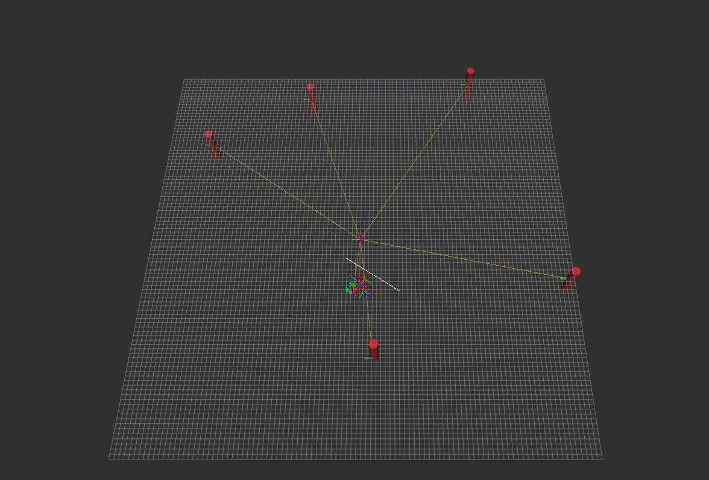
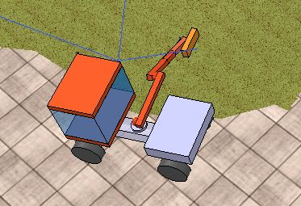
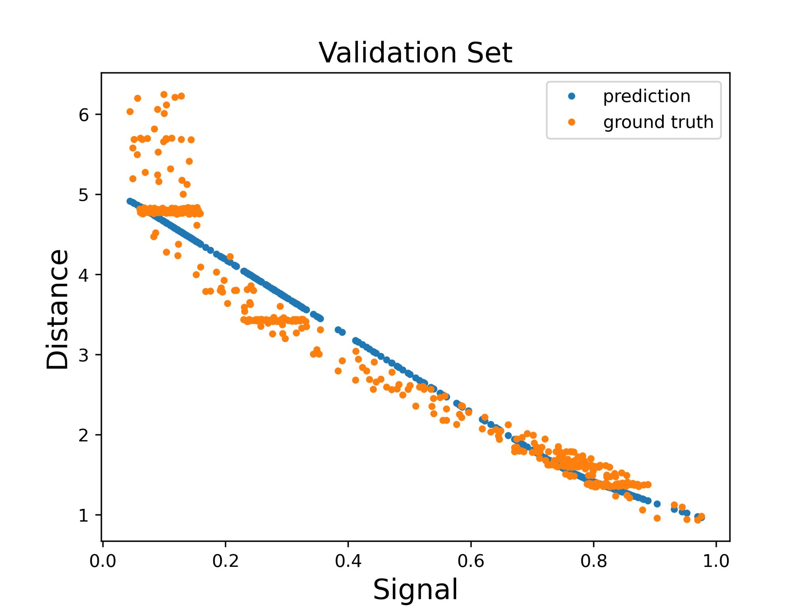
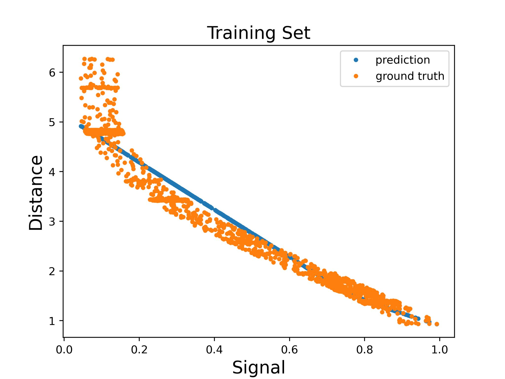
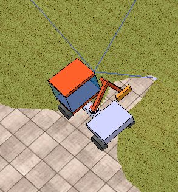
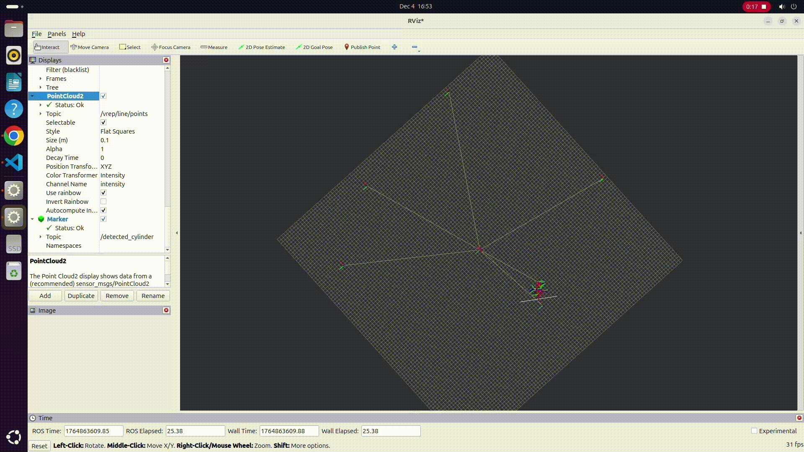
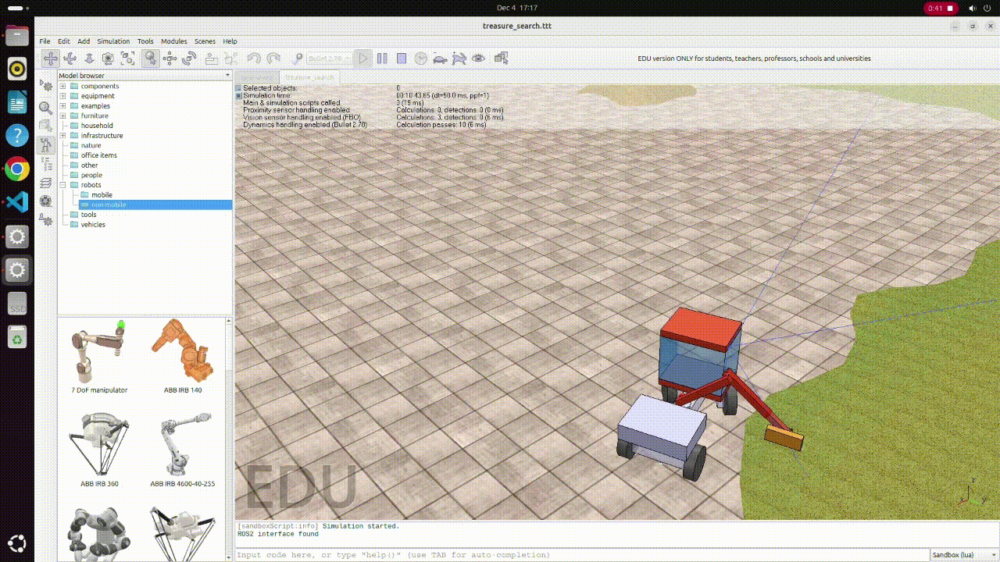

# Autonomous Robotic Treasure Search

**Multi-model imitation learning, sensor-based localization, and autonomous shoreline navigation in simulation**

**Fall 2025 · Georgia Tech-Europe · Machine Learning for Robotics · CS7644 project**

**Technologies:** ROS 2 · CoppeliaSim · Python/C++ · scikit-learn · Convolutional Neural Networks · Keras



> **Code availability:** The source code, trained model weights, and simulation configuration are not publicly distributed. This repository documents the system design, approach, experimental results, and demonstrations.

## Overview

This project explored autonomous treasure search with a simulated Ackermann-steered vehicle equipped with a robotic manipulator, cameras/depth sensors, and a proximity-based object detector. The robot had to operate along the boundary between paved ground and surrounding terrain while positioning its detection tool and estimating the locations of objects of interest.

The system combines three learning and estimation tasks:

1. **Treasure localization:** learn a mapping from detector signal to target distance, then aggregate measurements into spatial location estimates.
2. **Arm control:** use visual imitation learning to predict discrete arm-tip movements that keep the tool near the terrain boundary.
3. **Vehicle steering:** use a second visual imitation learning policy to steer along that boundary.

## Demonstrations

The final project included recorded simulation demonstrations. Video links will be added here after the footage is prepared for public sharing.

| Demonstration | What it shows |
| --- | --- |
| Treasure localization | Detector readings accumulated into target-location hypotheses |
| Arm boundary following | Vision-driven arm-tip adjustments near the shoreline |
| Vehicle boundary following | Vision-based left/straight/right steering behavior |



## System Design

```text
Simulated vehicle + robotic arm (CoppeliaSim / ROS 2)
    |
    +-- Proximity detector signal + tool position
    |       -> MLP distance estimator
    |       -> Candidate target positions around each reading
    |       -> Spatial voting + non-maximum suppression
    |       -> Estimated treasure locations
    |
    +-- Arm-mounted camera image
    |       -> CNN imitation-learning classifier
    |       -> 9 discrete arm actions
    |
    +-- Vehicle-mounted camera image
            -> CNN imitation-learning classifier
            -> 3 steering actions: left / straight / right
```

### 1. Learning to localize treasures

The proximity sensor returns a scalar signal that becomes stronger near an object of interest. Rather than only flagging high sensor readings, the localization pipeline learns to estimate the sensor-to-target distance with an `MLPRegressor`.

For measurements above a signal threshold, the algorithm generates candidate object locations around the current tool position at the predicted distance. Candidate coordinates are discretized and accumulated as votes. High-vote locations are then refined with non-maximum suppression to produce distinct estimated target positions.

**Evaluation described in the final presentation:**

- Distance model trained/evaluated on **2,176 examples**, with a **20% validation split**.
- Distance regression: **0.331 training RMSE** and **0.366 validation RMSE**.
- An evaluated simulation run compared predicted and reference coordinates for **five treasures**.
- The tabulated localization deviations average approximately **0.59** in the presentation's coordinate units. Although the slide labels this figure “mean square error,” its per-target values appear to be *Euclidean positional errors*, so it is reported here as an approximate mean positional deviation rather than MSE.

| Target | Reference (x, y) | Estimated (x, y) |
| --- | --- | --- |
| 1 | (42.70, 14.25) | (43.0, 14.0) |
| 2 | (-29.05, -3.325) | (-27.5, -3.5) |
| 3 | (27.65, 38.825) | (27.5, 39.0) |
| 4 | (-10.275, -48.725) | (-10.5, -49.0) |
| 5 | (48.10, -28.85) | (48.5, -29.0) |

<details>
<summary>Distance-regression evaluation figures</summary>

Training set:



Validation set:



</details>

### 2. Vision-based robotic arm control

An arm-mounted camera feeds a convolutional neural network trained from demonstrated arm movements. The controller predicts one of **nine discrete classes**, representing combinations of lateral and vertical arm-tip commands.

We  iterated on demonstration collection after observing cases where the arm extended too far and interfered with vehicle motion. Training examples were supplemented with recovery actions, and the simulated arm/vehicle motion speeds were adjusted to improve coordination.

### 3. Vision-based vehicle steering

A separate CNN processes images from the vehicle-mounted camera to classify steering into **left, straight, or right**. The final presentation documents **3,000 recorded training examples** for this policy.

Training data was expanded with recovery demonstrations from the terrain side of the boundary to help the vehicle steer back. Sharp turns remained a difficult case, highlighting how the distribution of demonstrations affects imitation-learning robustness.



## Engineering Lessons

- **Learning a sensor response is not the same as localizing an object.** Geometric candidate generation and multi-observation voting convert noisy distance estimates into spatial hypotheses.
- **The dataset must include recovery behavior.** A policy trained primarily on ideal trajectories can fail when the robot drifts away from the expected path.
- **Robot subsystems interact.** Arm reach, vehicle speed, steering, and sensor positioning affect one another even when separate models control them.
- **Limitations matter.** The demonstration exposed challenging sharp corners and arm/vehicle coordination cases; the system should not be treated as a fully validated production robot.

## Repository Contents

```text
.
├── README.md
├── assets/
│   ├── treasure-localization.png
│   ├── distance-train.png
│   ├── distance-validation.png
│   ├── arm-simulation.png
│   └── shoreline-navigation.png
└── videos/
    └── README.md
```

## 🎥 Project Demonstrations

### 1. Treasure Localization

Neural-network distance estimation and spatial voting for
accurately localizing buried objects.

<p align="center">
  
</p>

<p align="center">
  <a href="https://youtu.be/1eaPQyqI7f4">▶ Watch Full Treasure Localization Demo on YouTube</a>
</p>

---

### 2. Autonomous Navigation

CNN-based vehicle steering and robotic arm control for
autonomously following the terrain boundary.

<p align="center">
  
</p>

<p align="center">
  <a href="https://youtu.be/8dqPJ8IfNJI">▶ Watch Full Autonomous Navigation Demo on YouTube</a>
</p>

## Project Context

This was a collaborative course project at **Georgia Tech-Europe** (Fall 2025). The public repository is a technical showcase rather than a runnable distribution. Starter ROS packages, simulation assets, source code, and trained checkpoints are intentionally omitted.
